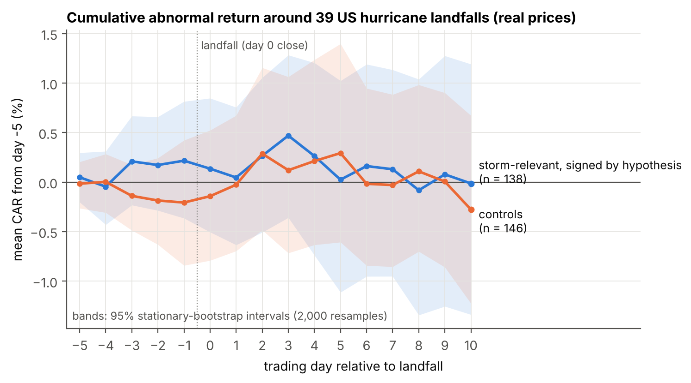
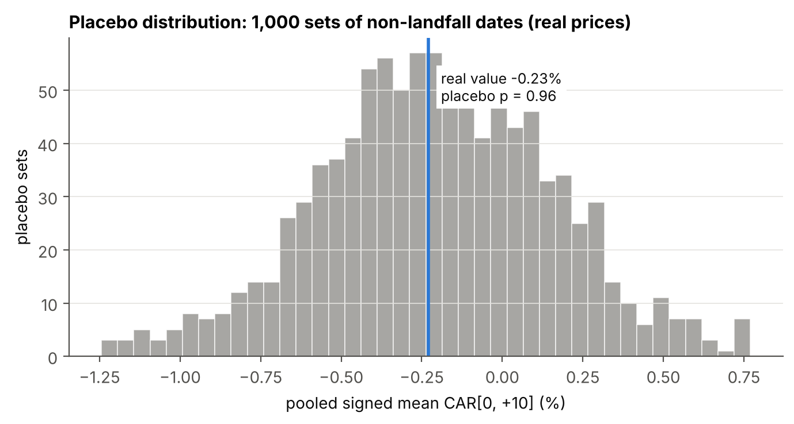
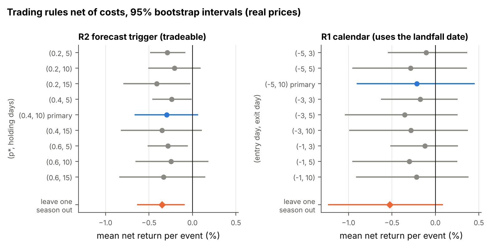
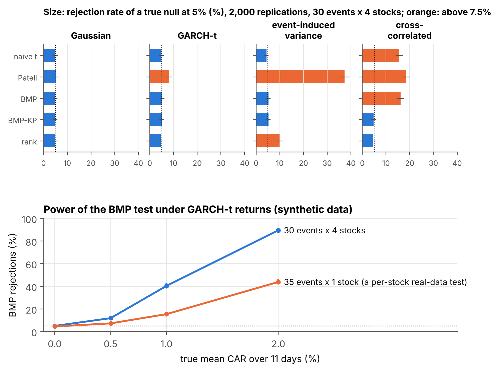
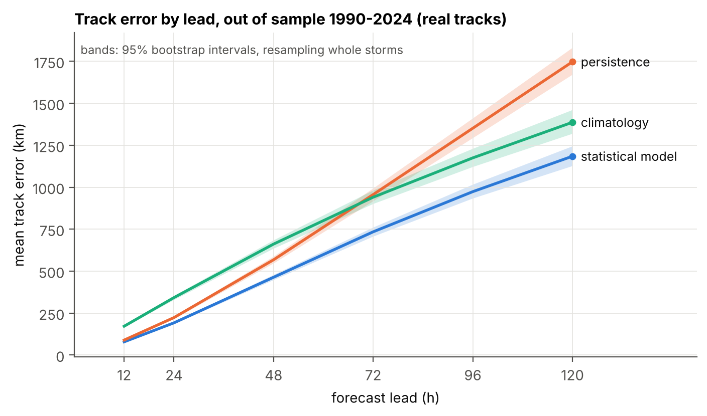
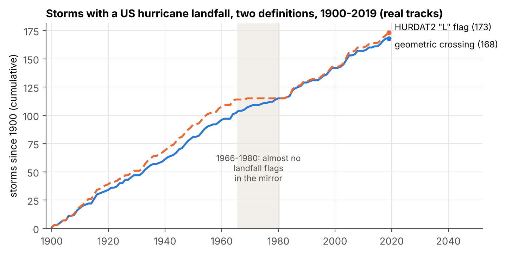
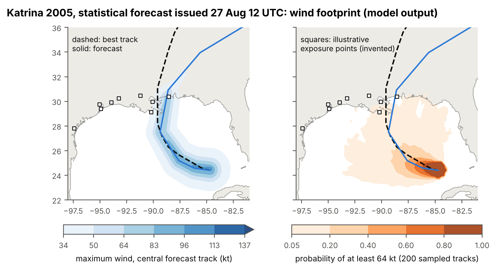

# Landfall: hurricane forecasts, wind footprints and event studies

Tools to test whether prices of hurricane-exposed securities reflect National Hurricane Center
(NHC) information around US landfalls, and one pre-registered real-data test: four storm-relevant
stocks and four controls around 39 US hurricane landfalls 1990-2022 show nothing (Holm-adjusted
p-values of 1.0; a forecast-trigger trading rule loses money out of sample), in a design whose
per-stock tests would detect a true 2% abnormal return only about 44% of the time.

**The project's central hypothesis is not tested here.** It concerns insurers, reinsurers and
orange-juice, natural-gas and lumber futures, and operational NHC forecasts; none of those prices or
forecasts were available where this was built. The null result above is about eight large US stocks
and a statistical forecast model. The protocol and the script for the real test are in this
repository ([Run it on your own prices](#run-it-on-your-own-prices-not-done-in-this-repository)).

## Status

| Feature | Implemented | Tested | Run on synthetic data | Run on real data |
|---|---|---|---|---|
| HURDAT2 parser (NHC text format) / two GitHub mirrors | yes / yes | fixture from the format document / yes | n/a | NHC file **not run** (not reachable) / mirrors 1851-2024 |
| ATCF a-deck reader, forecast availability rule | yes | fixture from the NRL documentation | n/a | **not run** (no a-deck file) |
| Landfall definitions (HURDAT2 flags, geometric crossing) | yes | yes | yes | yes (1851-2022) |
| Point-in-time statistical forecast (CLIPER-like) | yes | yes, incl. look-ahead guards | yes | yes (out of sample, 1990-2024) |
| Wind footprint, NumPy reference | yes | hand calculations, limiting cases | yes | model output for real forecasts only; not validated against observed winds |
| Wind footprint, C++ kernel (optimised and wave-1 reference) | yes | equal to NumPy within 1e-9; ASan/UBSan (GCC and Clang in CI) | yes (speed benchmark) | as above |
| Exposure scores, two exposure maps | yes | yes, incl. look-ahead guard | yes | no (the maps are invented) |
| Event-study tests (BMP, Patell, Kolari-Pynnonen, rank, bootstrap, placebo, Holm/BH) | yes | yes | yes (2,000 replications per cell) | yes (8 stocks, 1990-2022) |
| Trading rules, PSR, deflated Sharpe ratio, leave-one-season-out | yes | yes | yes (own-prices pipeline) | yes (4 stocks, 1990-2022) |
| Loader for user price files, `run_own_prices.py`, protocol | yes | yes, end to end | yes | **not run**: no insurer, reinsurer or futures prices here |
| Operational NHC forecasts (OFCL) in the study | reader only | fixture | no | **not run** |

## Results

Every number comes from a command in this repository; tables are pasted by `scripts/make_tables.py`
from `results/` (each `MANIFEST.txt` records command, seed, commit and environment) and
`scripts/check_readme_numbers.py` checks the README against the files. More tables (intensity
errors, definitions by era, dispersion, mirror comparison): [results/tables.md](results/tables.md).

### 1. Real-data event study: no finding, and what it could have found

`docs/protocol.md` fixed the events (48 storms with a geometric US hurricane landfall, 1990-2022;
39 after dropping overlapping windows), the stocks and their hypothesised signs, the windows, the
tests and what counts as a finding; it was committed (ac55c07) before any event return was computed
and before the results (2eeba12). The study was run once.

<!-- table:real_car -->
**CAR[0,+10] around US hurricane landfalls 1990-2022, %, 95% stationary-bootstrap interval (real data)**

| stock | group | events | mean CAR[0,+10] | BMP t | BMP p | Holm p | rank p | placebo p |
|---|---|---|---|---|---|---|---|---|
| HD | storm | 35 | 0.28 [-1.25, 1.77] | 0.12 | 0.908 | 1.000 | 0.795 | 0.142 |
| XOM | storm | 37 | 0.18 [-0.92, 1.43] | 0.12 | 0.908 | 1.000 | 0.876 | 0.588 |
| CVX | storm | 38 | 0.03 [-1.14, 1.31] | -0.03 | 0.976 | 1.000 | 0.965 | 0.890 |
| RRC | storm | 28 | -1.20 [-5.13, 2.66] | -1.06 | 0.300 | 1.000 | 0.877 | 0.442 |
| MSFT | control | 37 | 0.61 [-0.73, 2.05] | 0.69 | 0.494 | 1.000 | 0.396 | 0.210 |
| JNJ | control | 36 | -0.19 [-1.29, 0.91] | -0.37 | 0.712 | 1.000 | 0.241 | 0.360 |
| MRK | control | 35 | -0.28 [-2.40, 1.65] | -0.81 | 0.423 | 1.000 | 0.936 | 0.518 |
| PFE | control | 38 | -0.42 [-1.49, 0.60] | -0.52 | 0.605 | 1.000 | 0.673 | 0.194 |
<!-- /table:real_car -->

<!-- table:real_pooled -->
**Pooled tests, storm-relevant stocks signed by hypothesis (real data)**

| group | window | n | mean CAR, % [95% CI] | bmp_t | bmp_p | rbar | bmp_kp_p | rank_p |
|---|---|---|---|---|---|---|---|---|
| storm (signed) | pre[-5,-1] | 138 | 0.22 [-0.36, 0.81] | 0.74 | 0.46 | 0.001 | 0.496 | 0.633 |
| storm (signed) | post[0,+10] | 138 | -0.23 [-1.50, 0.81] | -0.569 | 0.57 | 0.001 | 0.601 | 0.907 |
| storm (signed) | full[-5,+10] | 138 | -0.01 [-1.34, 1.19] | -0.103 | 0.918 | 0.001 | 0.925 | 0.865 |
| control | pre[-5,-1] | 146 | -0.21 [-0.84, 0.42] | -0.754 | 0.452 | 0.002 | 0.516 | 0.697 |
| control | post[0,+10] | 146 | -0.07 [-0.89, 0.71] | -0.605 | 0.546 | 0.002 | 0.601 | 0.794 |
| control | full[-5,+10] | 146 | -0.28 [-1.23, 0.67] | -0.927 | 0.356 | 0.002 | 0.424 | 0.664 |
<!-- /table:real_pooled -->

Reading: **no finding.** No stock has a significant CAR by any test, before or after the
multiple-testing adjustment; the placebo distribution does not single out any stock; the signs of
XOM, CVX and RRC are opposite to the hypotheses; the pooled signed CAR[0, +10] is -0.23% (placebo
p = 0.96). **What the design could detect** (simulated GARCH-t returns, same tests, table below): with
120 asset-events a true 11-day CAR of 1% is detected about 40% of the time and 2% about 90%; with the
35 events of one stock, about 16% and about 44%. The per-stock nulls therefore exclude only
effects of several percent; the intervals in the table show which.

<!-- table:synthetic_power -->
**Power under GARCH-t: rejection rate at 5%, % (bias with Monte Carlo SE), 2000 replications (synthetic data)**

| design | delta | bias of mean CAR | naive_t | patell | bmp | bmp_kp | rank |
|---|---|---|---|---|---|---|---|
| 30 x 4 | 0.00% | -0.00007 (0.00014) | 5.0 | 8.2 | 5.1 | 5.1 | 4.7 |
| 30 x 4 | 0.50% | -0.00010 (0.00014) | 12.6 | 16.6 | 12.0 | 12.0 | 15.1 |
| 30 x 4 | 1.00% | +0.00030 (0.00014) | 40.6 | 46.2 | 40.5 | 40.6 | 52.6 |
| 30 x 4 | 2.00% | -0.00012 (0.00014) | 88.9 | 93.7 | 89.6 | 89.5 | 98.0 |
| 35 x 1 | 0.00% | +0.00007 (0.00026) | 4.7 | 7.5 | 4.7 | 4.7 | 4.3 |
| 35 x 1 | 0.50% | +0.00034 (0.00026) | 7.5 | 10.8 | 7.4 | 7.4 | 8.4 |
| 35 x 1 | 1.00% | -0.00001 (0.00026) | 14.6 | 19.7 | 15.6 | 15.6 | 19.4 |
| 35 x 1 | 2.00% | +0.00012 (0.00025) | 43.1 | 51.0 | 44.0 | 44.0 | 59.0 |
<!-- /table:synthetic_power -->



*Mean cumulative abnormal return from day -5, storm-relevant stocks signed by their hypothesis and
controls, with 95% stationary-bootstrap bands (real prices). It shows the path behind the pooled
test; it is descriptive (the bands are pointwise) and says nothing about insurers or commodities.*



*The pooled signed CAR[0, +10] on 1,000 placebo sets (same calendar weeks of years without a nearby
landfall) and the real value. It does not show per-stock placebo results (in the table above).*

<!-- table:trading -->
**Trading rules, net of costs, %, 95% stationary-bootstrap interval (real data)**

| rule | evaluation | events | mean net per event | Sharpe per event | PSR(0) | DSR of best of 9 |
|---|---|---|---|---|---|---|
| R1 calendar (not tradeable) | primary (-5, 10) | 39 | -0.21 [-0.90, 0.44] | -0.095 | 0.268 |  |
| R2 forecast trigger | primary (0.4, 10) | 121 | -0.30 [-0.66, 0.06] | -0.155 | 0.034 |  |
| R1 calendar (not tradeable) | leave-one-season-out | 39 | -0.52 [-1.23, 0.08] | -0.261 | 0.024 | 0.246 (best (-5, 3)) |
| R2 forecast trigger | leave-one-season-out | 152 | -0.35 [-0.63, -0.10] | -0.197 | 0.005 | 0.012 (best (0.2, 10)) |
<!-- /table:trading -->

Reading: **negative result.** The tradeable forecast-trigger rule R2 loses money after costs; in
leave-one-season-out evaluation its mean net return per event is -0.35% [-0.63, -0.10], and the
deflated Sharpe ratio of 0.01 for the best of its 9 configurations is far from the 0.95 the protocol
requires. The calendar rule R1 uses the realised landfall date, could not have been traded, and is
not better. Costs are assumptions (10 bp per side, 2 bp on the index hedge, 50 bp a year borrow);
doubling them makes both rules worse (`results/real_eventstudy/sensitivity_costs.csv`).



*Mean net return per event and 95% bootstrap interval for each of the 9 configurations of each rule
(primary in blue) and the leave-one-season-out evaluation (orange; real prices). It does not show
the time path of returns or any configuration outside the pre-specified grid.*

### 2. Event-study statistics on simulated returns (synthetic data)

Reading (size table with interval coverage in [results/tables.md](results/tables.md)): with
event-induced variance Patell rejects a true null 37% of the time while BMP stays at
5%; with cross-correlated returns the naive, Patell and BMP tests reject 16-18% while the
Kolari-Pynnonen adjustment and the rank test stay near 5%. Not shown: a wrong market model.



*Top: rejection rate of a true null at 5% by test and scenario, with 95% Monte Carlo error bars
(orange: above 7.5%). Bottom: power of the BMP test by true CAR for the two designs. Synthetic data;
it does not show the real data's correlation or variance structure.*

<!-- table:placebo_size -->
**Size of the placebo test and of the BMP test on null synthetic prices (60 replications x 4 assets, 39 events, 200 placebo sets; synthetic data)**

| test | level | tests | rejection rate, % (MC SE) |
|---|---|---|---|
| placebo | 0.05 | 240 | 15.8 (2.4) |
| placebo | 0.1 | 240 | 22.5 (2.7) |
| bmp | 0.05 | 240 | 5.0 (1.4) |
| bmp | 0.1 | 240 | 9.2 (1.9) |
<!-- /table:placebo_size -->

Reading: **the placebo test is anti-conservative.** On prices with no effect at all it rejects at
5% in 15.8% of tests (Monte Carlo SE 2.4), while BMP holds 5.0%. A likely reason: placebo dates
come from the same calendar weeks of about 31 years, so the placebo distribution is centred on that
pool's own mean, which differs from zero by sampling error. Both protocols require a Holm-adjusted
BMP p < 0.05 as well, so this does not create findings, but a small placebo p alone is weak
evidence. Found in this review after the real-data run; no reported number changes.

### 3. Point-in-time forecast skill (real tracks, best-track truth)

<!-- table:track_error -->
**Mean track error (km) by lead, out of sample 1990-2024, 95% storm-block bootstrap intervals (real data)**

| lead (h) | forecasts | storms | model | persistence | climatology | model - persistence |
|---|---|---|---|---|---|---|
| 12 | 10667 | 546 | 79 [76, 81] | 89 [86, 92] | 172 [166, 178] | -11 [-12, -9] |
| 24 | 10104 | 521 | 192 [186, 198] | 223 [215, 231] | 342 [330, 354] | -31 [-35, -28] |
| 48 | 8764 | 465 | 464 [449, 479] | 568 [548, 589] | 661 [636, 686] | -104 [-116, -92] |
| 72 | 7414 | 401 | 734 [708, 762] | 957 [918, 995] | 941 [902, 983] | -222 [-248, -196] |
| 96 | 6145 | 344 | 974 [935, 1017] | 1352 [1295, 1412] | 1175 [1123, 1231] | -378 [-423, -331] |
| 120 | 5055 | 280 | 1185 [1128, 1246] | 1748 [1672, 1832] | 1387 [1320, 1462] | -563 [-637, -492] |
<!-- /table:track_error -->

Reading: the model, fitted each season only on earlier seasons, beats persistence and climatology at
every lead. It is weak by operational standards (72-h error above 700 km) and stands in for NHC
forecasts only because those are not available here; its inputs are best-track values, cleaner than
what was known in real time, so these errors are if anything optimistic.



*Mean track error by lead with 95% storm-block bootstrap bands, 1990-2024 out of sample. It does not
compare with NHC official forecasts.*

### 4. Landfall definitions (real tracks)

At hurricane strength on the US coast the two definitions find almost the same number of
landfalls (333 flagged, 336 geometric, 1851-2019); the geometric rule finds more overall because it
counts small islands and re-entries. The "L" flags are incomplete: 12 of the 16 storms found only by the geometric rule are 1966-1980
US hurricane landfalls with no landfall entry at all in the rda mirror (among them Celia 1970,
Carmen 1974, Eloise 1975, David and Frederic 1979, Allen 1980), and 14 of the 22 found only by the
flags are flagged at 65 kt while the synoptic fixes the geometric rule interpolates are below 64 kt
(`results/landfall_counts/storm_level_disagreements.csv`). Whether the 1966-1980 gap is in HURDAT2
or only in the mirror was not checked.



*Cumulative number of storms with a US hurricane landfall since 1900 by definition. The flat flag
curve in 1966-1980 is the missing flags; the figure does not show where the definitions disagree
within a storm.*

### 5. Wind footprint and the C++ kernel



*Left: maximum surface wind of the central statistical forecast of Katrina issued 27 August 2005
12 UTC (fitted on 1950-2004); right: the probability of at least 64 kt from 200 sampled tracks
(C++ Monte Carlo kernel). Model output, not observed winds; the squares are an illustrative,
invented exposure map. It does not show NHC's forecast, which was much better than this model's.*

The kernel evaluates a Holland profile with motion asymmetry and inland decay at every (sampled
storm, half-hour step, point). The first (wave-1) C++ kernel was about as fast as NumPy (ratio of
medians 1.1). An instruction profile (callgrind, `experiments/profile_kernel.py`,
`results/benchmark/callgrind.csv`) shows why: 1,044 instructions per evaluation, 41% of them in sine
and cosine and 15% in `hypot`, nearly all in about fifteen scalar libm calls per evaluation, which
NumPy makes as well, so the compiled loop had little to gain. The optimised kernel computes the
point terms once per point and the storm terms once per (storm, step), gets the trigonometry of the
differences from half-angle identities and replaces `hypot` by `sqrt` where overflow cannot occur:
376 instructions per evaluation remain, 34% of them in `pow`. Results equal NumPy within 1e-9
relative (tests on random, polar, date-line and near-centre inputs; on the benchmark inputs the
largest relative difference is 2.94e-14).

<!-- table:benchmark -->
**Footprint Monte Carlo speed, 500 storms x 241 steps x 50 points, single thread, shared machine, indicative (synthetic inputs)**

| measurement | engine | reps | median (s) | min (s) | max (s) | ns per wind evaluation |
|---|---|---|---|---|---|---|
| wave 1 | numpy | 15 | 0.9902 | 0.7913 | 1.2585 |  |
| wave 1 | cpp (wave-1 kernel) | 15 | 0.9398 | 0.8265 | 1.0902 |  |
| wave 1 | ratio numpy / cpp (wave-1) | 15 | 1.1 | 0.7 | 1.5 |  |
| wave 2 | numpy | 15 | 1.072 | 0.822 | 1.279 | 178 |
| wave 2 | cpp reference (wave-1 kernel) | 15 | 1.071 | 0.947 | 1.308 | 178 |
| wave 2 | cpp optimised | 15 | 0.483 | 0.423 | 0.571 | 80 |
| wave 2 | ratio numpy / cpp optimised | 15 | 2.2 | 1.4 | 3.0 |  |
| wave 2 | ratio cpp reference / cpp optimised | 15 | 2.2 | 1.7 | 3.1 |  |
| wave 2 | ratio numpy / cpp reference | 15 | 1.0 | 0.6 | 1.3 |  |
<!-- /table:benchmark -->

Reading: the optimised kernel is **2.2 times faster than NumPy** (ratio of medians; range over runs
1.4 to 3.0) and than the wave-1 kernel, which again matched NumPy (ratio 1.0). The timing is
indicative: a shared 2-core machine, 1-minute load average 1.25 with another job on the second
core, all engines single-threaded and interleaved. What limits it: the remaining `pow`, `exp` and
`asin` calls are scalar glibc calls; vectorising them would need `-ffast-math` or a vector math
library, which is not used so that results stay reproducible across compilers and machines.

### 6. Data checks and the test suite

Every fix of the dplyr mirror matches a fix of the rda mirror (`results/data_checks/`); the loader
repairs and reports defects of the rda mirror. The official NHC file could not be downloaded here.

<!-- table:mutation -->
**Mutation check of the test suite (tests/mutation_check.py): 21 of 21 mutants caught.**

M1 estimation window overlaps the event window (no 30-day gap); M2 off-by-one in the event-day index; M3 abnormal return with the wrong sign; M4 forecast features use the position 12/24 h after t instead of before; M5 training seasons include the test season; M6 residual variance with T - 1 instead of T - 2 degrees of freedom; M7 bootstrap block length ignored (always i.i.d.); M8 trading cost charged once instead of on entry and exit; M9 Sharpe annualised with k instead of sqrt(k); M10 deflated Sharpe ratio ignores the number of trials; M11 inland decay starts 6 h before landfall (NumPy); M12 Holland profile uses exponent 1/B instead of B; M13 Kolari-Pynnonen factor without the (N - 1) term; M14 rank test centred at L/2 instead of (L + 1)/2; M15 Holm replaced by Bonferroni; M16 forecast public at its synoptic time (availability delay ignored); M17 placebo dates not kept away from landfalls; M18 HURDAT2 west longitudes read as east; M19 translation asymmetry factor k(Rm) = 1 instead of 1/2 (NumPy); C1 C++ kernel: inland decay rate 0.95 / h instead of 0.095 / h; C2 C++ kernel: wind direction clockwise (southern-hemisphere rotation).
<!-- /table:mutation -->

## Run it on your own prices (not done in this repository)

The test of the central hypothesis needs daily closes of insurers, reinsurers and futures, which
this repository does not contain and must never contain. `docs/protocol_own_prices.md` pre-specifies
the run (written before any such price was seen): the 39 events, the assets and hypothesised signs
(insurers and reinsurers negative, orange juice and lumber positive, natural gas two-sided),
windows, tests, the multiple-testing family, the placebo, what counts as a finding and the trading
rules.

1. Copy `docs/protocol_own_prices.md` to `docs/protocol_own_prices_<initials>.md`, fill in its run
   record (price source, index, available assets), and write `assets.csv` from
   `docs/own_prices_assets.csv`. **Commit both before loading any price.**
2. Export daily closes to a CSV outside the repository (or in the git-ignored `data/`): a `date`
   column (YYYY-MM-DD) and one column per asset plus the S&P 500 (`SPX`), or the long format
   `date,asset,price`. Stocks adjusted for splits and dividends; futures as ratio-adjusted
   continuous series. Schema and checks: `landfall/prices.py`.
3. Run (after `pip install -e .`; no track data or C++ build is needed):
   ```bash
   python scripts/run_own_prices.py --prices /path/to/prices.csv --assets assets.csv \
       --market SPX --label real --specifications 1
   ```
   `--specifications K` counts every asset list or setting you have run, discarded runs included;
   the deflated Sharpe ratio then uses N = 9 K trials.
4. Read `results/own_prices/`: `data_checks.csv` (gaps, stale series, jumps: look first),
   `coverage.csv` (events per asset), `car_tests.csv` and `pooled.csv` (CARs and tests, with Holm
   and BH p-values), `placebo.csv`, `findings_event_study.csv` (the protocol's criteria),
   `trading_*.csv` and `findings_trading.csv` (R1, R2, deflated Sharpe ratio), `sensitivity_*.csv`,
   and `MANIFEST.txt` (SHA-256 of the price file and of `assets.csv`, never the prices).
   A finding needs a Holm-adjusted p < 0.05, a placebo p < 0.05 and the hypothesised sign; anything
   else is "no evidence", to be reported with the bootstrap interval and the power above.

Here it was run only on synthetic prices without any effect (`scripts/make_synthetic_prices.py`):
no finding, but 4 placebo p-values below 0.05 (see section 2). `tests/test_own_prices.py` checks that
it finds an injected -6% effect on two insurers and nothing else.

<!-- table:own_prices_synthetic -->
**scripts/run_own_prices.py on SYNTHETIC prices without any injected effect (13 series, 39 events, 1000 placebo sets, 114 s; synthetic data)**

| asset | group | events used | mean CAR[0,+10], % | Holm p | placebo p | finding |
|---|---|---|---|---|---|---|
| ALL | storm | 39 | -2.16 [-3.87, -0.72] | 0.333 | 0.028 | no |
| TRV | storm | 39 | 0.52 [-1.10, 2.42] | 1.000 | 0.908 | no |
| UVE | storm | 39 | -0.24 [-1.56, 1.00] | 1.000 | 0.824 | no |
| HCI | storm | 15 | 0.21 [-2.36, 2.55] | 1.000 | 0.850 | no |
| RNR | storm | 39 | -0.23 [-1.43, 0.99] | 1.000 | 0.858 | no |
| EG | storm | 39 | 0.23 [-1.51, 1.96] | 1.000 | 0.958 | no |
| OJ | storm | 39 | 0.74 [-0.40, 1.97] | 1.000 | 0.192 | no |
| LUMBER | storm | 39 | 0.31 [-1.38, 1.94] | 1.000 | 0.132 | no |
| NG | storm | 39 | -1.44 [-2.82, -0.00] | 1.000 | 0.002 | no |
| MSFT | control | 39 | 1.10 [-0.66, 2.78] | 1.000 | 0.048 | no |
| JNJ | control | 39 | 0.62 [-0.96, 2.13] | 1.000 | 0.672 | no |
| MRK | control | 39 | 0.56 [-0.90, 1.84] | 1.000 | 0.410 | no |
| PFE | control | 39 | -0.09 [-1.50, 1.56] | 1.000 | 0.856 | no |
<!-- /table:own_prices_synthetic -->

## Reproduce

```bash
python -m pip install -e ".[test,prices]"   # Python >= 3.12
python scripts/fetch_data.py                 # HURDAT2 mirrors into data/raw/, SHA-256 checked
cmake -S . -B build -G Ninja && cmake --build build && ctest --test-dir build
python -m pytest -q                          # data tests skip if data/raw/ is empty
bash scripts/reproduce.sh                    # every result, table and figure (results/MANIFEST.txt)
bash scripts/reproduce.sh --mutation         # also the mutation check
```

Sanitizers: `cmake -S . -B build-asan -DLANDFALL_SANITIZE=ON -DCMAKE_BUILD_TYPE=Debug`. NHC file:
`python scripts/fetch_data.py --source nhc` (not exercised here). Re-running the real study gives
the same numbers (fixed seed). ATCF a-decks (`landfall.data.atcf`) give forecasts as issued.

## Method

**Tracks and landfalls.** HURDAT2 mirrors. Geometric landfall: 10-minute interpolation, first step
on land (1/120-degree mask) after at least 1 h at sea, inside a stated US polygon.

**Forecast.** For each synoptic fix t, ridge regressions (lambda = 1) fitted on seasons 1950 to
season(t) - 1 predict displacement and intensity change at 12-120 h from position, intensity,
recent motion, day of year and quadratic terms; joint in-sample residual vectors give sampled
tracks; the share entering US land within 120 h is the landfall probability.

**Footprint.** Holland (1980) profile $V(r) = V_m\sqrt{(R_m/r)^B e^{1-(R_m/r)^B}}$, $B$ from the
pressure deficit (clipped to [1, 2.5]), $R_m$ from Willoughby et al. (2006) or the 34-kt radii,
motion asymmetry after Phadke et al. (2003), inland decay $V(t) = V_b + (R V_0 - V_b)e^{-\alpha t}$
(Kaplan and DeMaria 1995). Exposure: expected Emanuel (2011) damage fraction over weighted points.

**Event study.** Market model on days -280..-31, abnormal returns on -5..+10,
$\mathrm{Var}(CAR) = s^2[D + D^2/T + (\sum_w (R_{mt}-\bar R_m))^2/S_{xx}]$; BMP
$t = \overline{SCAR}/(s_{SCAR}/\sqrt N)$, Kolari-Pynnonen factor $\sqrt{(1-\bar r)/(1+(N-1)\bar r)}$,
Corrado-Cowan ranks, stationary bootstrap, placebo dates, Holm and Benjamini-Hochberg. Trading:
market-hedged, equal ex-ante residual risk, costs per side; PSR and DSR with
$SR_0 = \sqrt{V}[(1-\gamma)\Phi^{-1}(1-1/N) + \gamma\Phi^{-1}(1-1/(Ne))]$ (reproduces the worked
example of Bailey and Lopez de Prado 2014). User-supplied series: each asset on the dates on which
it and the index both have a close.

## Limitations

- The stocks are not insurers or commodities: HD, XOM, CVX and RRC have plausible but indirect
  hurricane links, so the null says nothing about the central hypothesis.
- One control set (MSFT, JNJ, MRK, PFE), chosen as having no obvious link; no matched controls.
- Daily closes only; landfall times are matched to the first close at or after landfall (taken as
  20:00 UTC), so intraday reactions and the timing of advisories are not resolved.
- The forecast model is CLIPER-like and far worse than NHC forecasts; it uses best-track values
  as inputs and in-sample residuals from storms lasting 120 h, which understates uncertainty.
- skfolio prices: split-adjusted, dividend adjustment of the stocks not verified independently; the
  S&P 500 series is a price index (no dividends). RRC has stale prices before 1996 (screened).
- Per-stock tests have about 35 events and low power (about 16% for a 1% CAR).
- Footprint: no Coriolis or inflow angle, a fixed surface factor, constant $R_m$ and $B$ along a
  sampled track, decay that continues after a return to sea; not validated against observed
  winds. The exposure maps are invented.
- Geometric landfalls treat lakes as land and count small islands; the mirror's "L" flags are
  incomplete.
- The bootstrap under-covers slightly; the rank test over-rejects under event-induced variance;
  the placebo test over-rejects (section 2).
- Trading costs are assumptions; no market impact. Kernel timings come from a shared machine.
- The Clang sanitizer build was run in CI only (its runtime is missing in the build sandbox).

## References

- Bailey, D. H., and M. Lopez de Prado (2012). The Sharpe ratio efficient frontier. *Journal of Risk* 15(2).
- Bailey, D. H., and M. Lopez de Prado (2014). The deflated Sharpe ratio: correcting for selection bias, backtest overfitting and non-normality. *Journal of Portfolio Management* 40(5), 94-107.
- Benjamini, Y., and Y. Hochberg (1995). Controlling the false discovery rate: a practical and powerful approach to multiple testing. *JRSS B* 57, 289-300.
- Boehmer, E., J. Musumeci, and A. B. Poulsen (1991). Event-study methodology under conditions of event-induced variance. *Journal of Financial Economics* 30(2), 253-272.
- Corrado, C. J. (1989). A nonparametric test for abnormal security-price performance in event studies. *Journal of Financial Economics* 23, 385-395.
- Cowan, A. R. (1992). Nonparametric event study tests. *Review of Quantitative Finance and Accounting* 2, 343-358.
- Emanuel, K. (2011). Global warming effects on U.S. hurricane damage. *Weather, Climate, and Society* 3, 261-268.
- Holland, G. J. (1980). An analytic model of the wind and pressure profiles in hurricanes. *Monthly Weather Review* 108, 1212-1218.
- Holm, S. (1979). A simple sequentially rejective multiple test procedure. *Scandinavian Journal of Statistics* 6, 65-70.
- Kaplan, J., and M. DeMaria (1995). A simple empirical model for predicting the decay of tropical cyclone winds after landfall. *Journal of Applied Meteorology* 34, 2499-2512 (constants as in NHC's `decayo.f90`).
- Kolari, J. W., and S. Pynnonen (2010). Event study testing with cross-sectional correlation of abnormal returns. *Review of Financial Studies* 23(11), 3996-4025.
- Patell, J. M. (1976). Corporate forecasts of earnings per share and stock price behavior: empirical tests. *Journal of Accounting Research* 14(2), 246-276.
- Phadke, A. C., C. D. Martino, K. F. Cheung, and S. H. Houston (2003). Modeling of tropical cyclone winds and waves for emergency management. *Ocean Engineering* 30(4), 553-578 (eq. 12 as implemented in the R package stormwindmodel; the paper itself was not read).
- Politis, D. N., and J. P. Romano (1994). The stationary bootstrap. *JASA* 89, 1303-1313.
- Roll, R. (1984). Orange juice and weather. *American Economic Review* 74(5), 861-880.
- Willoughby, H. E., and M. E. Rahn (2004). Parametric representation of the primary hurricane vortex. Part I. *Monthly Weather Review* 132, 3033-3048.
- Willoughby, H. E., R. W. R. Darling, and M. E. Rahn (2006). Parametric representation of the primary hurricane vortex. Part II. *Monthly Weather Review* 134, 1102-1120.
- Data and formats: NHC HURDAT2 format description; NRL ATCF format; HURDAT2 mirrors in the R packages HURDAT (T. Trice, MIT licence) and dplyr (`storms`); land mask from `global-land-mask` (T. Karin, MIT licence, GLOBE data); prices from the Python package skfolio.

## Disclaimer

Educational research project. Not investment advice.
